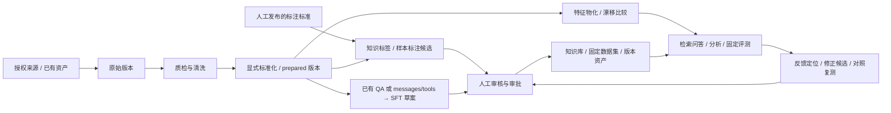

# Cognida

**以 Agent 为执行内核的数据与知识平台。** 把分散的数据、文档和业务问题，转化为可追溯的数据资产、知识库、特征、训练与评测数据集，以及可复核的分析报告。

[](services/cognida-go/go.mod) [](services/cognida-python/pyproject.toml) [](apps/cognida-web/package.json) [](LICENSE)

Cognida 支持两种工作习惯：从一项能力开始，直接清洗、标注、构建监督微调（SFT）数据集或分析已有数据；也可以提交业务目标，由 Supervisor 提出计划，经确认后交给持久任务控制器分发执行。数据处理、人工审核、发布与反馈使用共同的资产版本和权限体系。

[整体架构](#整体架构) · [核心能力](#核心能力) · [完整场景](#完整场景技术支持与故障排查) · [快速开始](#快速开始) · [开发与验证](#开发与验证) · [验收与生产边界](#验收与生产边界)

> 文档整理：**2026-10-27**；实现核对基线：`df6d497`。下文区分当前代码能力、历史测试证据与业务落地条件；历史验收日期不随文档更新改变。

## 整体架构


架构图表达平台的目标职责与技术布局。当前实现按下表对应；具体能力的执行入口、部署开关和验收范围见后文。图中的全部组件不代表在默认部署中同时启用。

| 层次 | 职责 | 当前实现与技术栈 |
| --- | --- | --- |
| **L1 业务交互与工作台** | 目标输入、任务与审批、数据工程、知识问答、研究分析和评测 | Vue 3、TypeScript、Vite、Pinia、Element Plus；SSE 展示运行进度，A2UI 展示分析结果 |
| **L2 API 接入与治理** | 认证、工作空间与资源授权、幂等、内部服务认证、请求追踪 | Go / Gin 提供 REST 与 SSE；Go 与 Python 经认证 HTTP、gRPC、MCP 通信 |
| **L3 智能规划与任务控制** | 目标澄清、候选计划、依赖分发、预算、取消、恢复和重规划 | Supervisor + TaskControl；Lifecycle 管理资产阶段、流水线和审批发布 |
| **L4 数据与知识领域引擎** | 采集与 HF 接入、清洗准备、标准与打标、SFT、特征与漂移、数仓、检索研究、评测返工 | Go 领域服务维护状态与合同，Python 执行解析和计算；同一服务可从页面、API 或已注册 Agent 工具调用 |
| **L5 Agent Runtime 与执行计算** | Agent 推理与工具执行、模型调用、分析计算、查询适配和受控代码运行 | Eino、Go 工具与委派；Python / FastAPI / pandas / NumPy / SciPy；多引擎查询适配器；可选 Docker Sandbox |
| **L6 数据与基础设施** | 元数据、任务与版本、向量、关系、队列和不可变文件 | MySQL、Milvus、Neo4j、Redis、本地对象存储；Docker Compose 编排开发部署 |

存储各司其职：**MySQL** 保存业务状态、审批、数据源配置和记忆；**Milvus** 承载知识向量与混合检索；**Neo4j** 保存图谱与血缘；**Redis** 承载队列、缓存、进度和 ResultStore；**本地对象存储** 保存版本资产、数据集与报告。Compose 中的 MinIO / etcd 服务于 Milvus，业务资产当前没有因此自动切换到 S3。

可观测性已有 OpenTelemetry 接线与 MySQL Trace 存储；Grafana / Loki 是 [独立可选部署](deploy/loki/)，不随根 Compose 默认启动。

### Supervisor、控制器与领域 Agent 如何协作

| 角色 | 负责什么 | 执行边界 |
| --- | --- | --- |
| **Supervisor** | 澄清目标，依据当前授权能力提出类型化计划，汇总已持久化的执行事实 | 不直接执行任务，不代替人工审批 |
| **TaskControl** | 固定计划版本，按 DAG 依赖分发；预留预算、维护租约与子任务句柄，处理取消、恢复和未来节点重规划 | 未知提交先查询核对；服务重启不等于无条件重放 |
| **领域 Agent / 执行适配器** | 将具体工作交给采集、清洗、标注、特征、数仓、研究等领域服务 | 既有模型推理，也有确定性的规则和计算；以实际注册的可执行适配器为准 |
| **Lifecycle 与治理服务** | 管理原始/派生资产、阶段结果、审核记录、发布回执与来源关系 | 候选、机器检查通过和人工批准是不同状态 |

当前持久编排接入了 HF 导入、SFT 草案、质检/清洗/准备/增强/评估固定 preset、采集、知识标签与部分样本标注、特征、离线评测、研究、数仓及可选 Sandbox。**能力声明不等于可被编排执行**：例如发布和数据分析仍通过独立 Lifecycle 能力或流水线模板完成；关系标注有独立入口，尚不在 TaskControl 的标注适配器集合中。

运行时的 Lifecycle 准备节点使用固定 preset，不能替代独立准备页面里的任意字段映射配置。任务中的评测适配器评分已有答案，完整的 QA/RAG/Agent/SQL 在线评测由评测服务提供。

### 数据怎样形成闭环



清洗与标准化先于新标注任务。特征工程、知识标签、样本标注和 SFT 是按目标选择的分支，不必机械地串行经过全部能力。合格的已有资产可以从相应阶段进入。

发布目标也不同：文本资料进入知识库并建立索引；表格发布为版本对象，可关联数据目录；受管数据库写入走 Operations / 数仓的独立确认与审批流程。普通资产发布不会自动写入外部业务数据库。

## 核心能力

### 数据采集、质量与准备

| 能力与页面入口 | 实际产物与行为 |
| --- | --- |
| 采集 `/collection-tasks`、API 来源 `/api-sources` | 网页采集产生候选；认证 GET JSON API 支持受管凭据、分页、限额、快照、检查点与取消 |
| 资产接入 `/pipelines` | 手工文本/表格、知识文档、采集结果、数据库表、查询结果和评测结果进入生命周期资产，固定来源与版本 |
| Hugging Face `/hf-datasets` | 搜索、数据卡、固定 commit 文件检查、有界预览和静态文件导入；页面/API/工具独立使用，也可作为 `huggingface.import` 零输入任务节点 |
| 文档解析 | TXT、Markdown、HTML、CSV、PDF 文本层、DOCX、XLSX、PPTX；保留 Office 表格和多工作表处理能力 |
| 质检与清洗 `/quality`、`/pipelines` | 质量诊断、清洗预览、分页差异、移除原因与内容摘要复查；生成新版本，保留原始输入 |
| 标准化 `/data-preparation` | 从清洗资产显式映射字段，校验类型与必填项，规范化换行；支持资料列到知识正文的投影，输出可核验的 prepared 版本 |

HF 当前处理 **JSON / JSONL / CSV / Parquet** 静态文件；前三类支持 gzip。单次最多 4 个文件、每文件 8 MiB、合计 16 MiB、最多 1,000 行，并由用户明确选择列；不执行数据集脚本，也不是全量 Hub 镜像。独立导入与持久任务的恢复/取消合同不同，不能互相推断。文件、解压和产物限制见 [独立数据能力说明](docs/implementation/standalone-data-capabilities.md)。

旧二进制 Office 文件需先转换；没有正文的 PDF 在未配置 OCR 时明确失败。新采集和重跑产生候选，不直接覆盖已发布知识。上游快照不等于通用 CDC，专用企业连接器仍须按业务系统实现。

### 打标、SFT 与固定数据集

| 能力与页面入口 | 实际产物与行为 |
| --- | --- |
| 标准库 `/label-standards` | 定义标签集合、适用/排除规则、例子及数量约束；人工发布后形成不可变标准 |
| 知识标签 `/labeling` | prepared 资产绑定已发布标准；规则与结构化模型输出作为待审建议，审核后的标签可应用于真实知识检索 |
| 样本标注 `/labeling` | 分类、实体、关系与问答样本；证据位置对应固定文本，人工修改受保护，保留审核与来源记录 |
| SFT `/sft-datasets` | 从已有 QA 列或 messages/tools 构建草案，检查回合结构、工具调用闭合、受限 JSON Schema、重复提示及 split/group 泄漏；审核发布后导出固定版本 JSONL |
| 数据集与评测 `/datasets`、`/evaluation` | 固定样本、指南、审核修订、来源、划分和摘要；QA/RAG/Agent/SQL profile 校验与固定配置评测 |

`governance.sft` 已接入 Supervisor 持久任务，但任务成功仅表示 **SFT 草案已构建**。人工审核与发布仍是独立动作。当前最多处理 1,000 行，不生成缺失答案、不执行样本里的工具，也不启动训练；业务上的“不可答”标记须在准备阶段明确处理。

划分检查覆盖原始内容与审核后最终消费的问题，包含精确重复和规则近重复检测；这不等于完整的语义泄漏证明。自动标签和答案需要与独立专家金标准比较，标准定义本身不保证质量。

### 特征、漂移与数据仓库

| 能力与页面入口 | 实际产物与行为 |
| --- | --- |
| 特征工程 `/features` | 字段、受限表达式、窗口聚合、固定模型 revision 的 embedding；全量/增量物化、回填、撤回、精确数值与事件时间/可用时间查询 |
| 漂移 `/drift` | 基线审批，数值分布、类别、缺失率与 schema 比较；定时监控、通知和治理任务草稿 |
| 数据源 `/datasource`、分析 `/analysis` | MySQL、PostgreSQL、ClickHouse、Doris、StarRocks、Hive、BigQuery 查询适配；外部数据源只读，结果有界并保留精确类型 |
| 数仓 `/warehouse` | 主题域、事实粒度、维度关系、分层 DAG；受限投影、多对一左联、聚合、基数检查、增量/回填、水位及表列血缘；审批后切换受管版本 |
| 受控写入 `/operations` | 受管目标上的类型化 DML / ETL、暂存版本、身份与内容绑定确认、事务幂等回执及回退 |

Hive / BigQuery 支持持久异步作业、分页、恢复和取消；BigQuery 包含凭据引用、dry-run 与扫描预算，但尚无真实 GCP 项目验收。支持的认证方式与实际引擎版本见 [查询适配矩阵](docs/implementation/query-adapters.md)。

当前特征同步处理上限 1,000 行，持久物化上限 10,000 行 / 100,000 单元格；数仓建模最多 8 个节点 / 10,000 行，不支持任意 SQL、DDL、脚本或删除传播，迟到数据需回填。它们适合有界数据产品和验证任务，生产容量须单独测量。

漂移显示的是距离与样本量，不是 p 值；监控默认绑定选定快照，持续读取新上游批次需要额外配置。特征 embedding 要求可信固定 revision，当前真实模型物化仍未验收。

### 知识、记忆、分析与研究

| 能力与页面入口 | 实际产物与行为 |
| --- | --- |
| 知识管理 `/knowledge`、知识问答 `/kb-assistant` | 检索增强生成（RAG）：REST 与 Agent 共用检索能力；授权范围内的向量/BM25、融合重排、查询重写、HyDE、多跳与标签过滤；图谱按知识库配置启用 |
| Data Agent `/analysis/chat` | 语义取数、Text2SQL、自我修复、Python 分析与 A2UI 结果画布；结果保留来源与工具回执 |
| DeepResearch `/research` | 持久研究运行、预算内补查、逐主张证据、支持/冲突/不足状态、同源归并和经过检查的部分结果 |
| 私人长期记忆 | tenant/user 隔离，显式保存、管理与每轮召回；个性化问答不共享答案缓存 |

私人记忆当前在最多 500 条近期候选中做词法与向量排序，不是全库 ANN，也不自动在用户之间共享；研究流程不自动读取私人记忆。详见 [记忆合同](services/cognida-go/internal/service/memory/README.md)。个人 Agent 默认配置按用户与工作空间保存，在每次新运行开始时读取，会话显式参数优先，已启动任务保持原参数，见 [配置生效规则](services/cognida-go/internal/service/agent/preferences.md)。

受控研究路径限制为 3 个子问题、20 个来源、120 秒及最多 4 次模型调用。引用与语义检查有助于追溯和识别不足，仍需根据业务风险核实结论。


### 反馈返工与策略进化

`/feedback` 将失败或纠正定位到来源与版本，生成有预算的返工和隔离候选，再用相同样本及目标配置复测。通过门槛比较后，由人审批激活，保留回退、撤回与来源撤权检查。

`/suggestions` 管理六类策略的基线、候选、固定评测、确切版本审批和激活回执：清洗/检索调整受限参数，经验/Skill/Playbook 提供指导文本，编排调整并发上限。执行固定策略快照，候选不能直接影响正式运行。

这里的“自进化”是**数据、知识和执行策略的受控改进闭环**。当前不自动改代码、扩大工具权限或训练模型；Agentic RL、模型微调与部署不在现有交付范围。共享经验蒸馏、召回和 Skill 落地默认关闭；当前私人记忆装配还对共享蒸馏/召回施加禁用保护，不能仅靠打开开关获得共享经验闭环。

### 权限、一致性与执行隔离

- **身份与资源**：消息与会话按用户和工作空间隔离，审计按工作空间隔离；数据源管理校验所有者或管理员，修改连接目标时不能把旧密码静默复用到新端点。
- **写入与重试**：受保护 HTTP 写操作的幂等键绑定身份、实际路径与请求载荷；相同键不同内容返回冲突。人工确认绑定具体内容和版本，不能拿旧确认执行新计划。
- **资产与索引**：受控消费重新核验来源权限、状态、版本或摘要；知识分块编辑/删除同步投影，陈旧索引不能继续作为有效正文返回。
- **交互状态**：工作空间切换隔离旧请求与 SSE；同一身份的成员信息刷新保留草稿，迟到历史响应不覆盖新回答；中断与保存失败会显示在结果回执中。
- **Sandbox `/sandbox`**：固定摘要镜像、非 root、只读根、禁网、资源/时间/输出限额、真实产物校验与取消回收。默认关闭，当前验收 profile 为显式授权的受控开发环境，不是多租户恶意代码的强隔离认证。

## 完整场景：技术支持与故障排查

目标：把授权的故障资料整理成可检索知识，并把已有正确问答整理成可审核的 SFT 数据；后续 Agent 回答排障问题时能引用真实资料。

1. 在 `/hf-datasets` 或采集入口确认来源、固定版本与字段；参考验收使用 `nvidia/TechQA-RAG-Eval` 的固定文件。
2. 在 `/tasks` 请求生成 **HF 导入 → 清洗 → prepared 准备 → SFT 草案** 的计划，检查预算与列映射后显式保存、启动；每个节点产生独立领域回执。
3. 在 `/sft-datasets` 核对已有问题、参考答案和划分，人工审核、发布并导出 JSONL。参考答案作为监督输入，不作为模型预测成绩。
4. 知识分支通过 `/data-preparation` 将资料列投影为正文，避免将问答列混入知识证据；绑定已发布标准，生成并审核知识标签。
5. 通过流水线审批发布到指定知识库，等待实际索引完成，再将审核标签关联到发布产物。
6. 在知识问答中检索并回答，核对引用、实际向量检索来源以及保存的回答/工具回执；失败结果可进入反馈返工。

该场景已有真实模型、服务、存储和浏览器验收，正向主链只使用两条可答记录，并保留原始不可答记录的负例；不能据此推断整个数据集的准确率。步骤、固定提交、历史失败与重启核对见 [Supervisor HF/SFT 场景验收](apps/cognida-web/e2e/ACCEPTANCE-2026-10-16-SUPERVISOR-HF-SFT.md)。

每一步也可独立使用：已有清洗资产直接标准化，已有 prepared 资产直接打标或构建 SFT，已有知识库直接检索研究。页面、REST API 和已注册 Agent 工具调用相同授权服务，审批与发布不向模型工具开放。

## 企业应用场景

以下是可由现有能力组合的实施方案，仍需专用接入、业务标准和专项验收。

| 需求 | 可交付结果 | 落地重点 |
| --- | --- | --- |
| **产品质量跨系统调查**：关联投诉、生产批次、质检、固件与维修记录 | 影响范围、证据报告、故障标签与特征、排障知识、SFT 样本 | 对齐设备/批次/版本标识；根因由业务验证，相关性不能直接当因果 |
| **持续更新的业务数据产品**：建立电商退货治理数据集 | 统一口径的业务表、退货标签、商品/渠道特征、售后知识和报告 | 订单实体关联、增量触发、金额与数量复算、迟到数据及历史特征防泄漏 |
| **上游变化的影响分析与修复**：金额单位、状态枚举或字段变化 | 下游影响清单、映射/重算候选、回归差异、版本切换与回退证据 | 接入变更事件与消费者登记；验证业务口径、下游答案和旧版本可用性 |
| **面向具体 Agent 的训练与评测数据**：订单、退货、物流异常 | 有来源与审核的 QA/messages/tools、独立评测集、覆盖缺口报告 | 任务覆盖矩阵、脱敏、专家金标准、客户/会话/时间划分与真实工具轨迹；训练另行接入 |
| **真实失败驱动的 Agent 改进**：知识过期、检索失败、数据错误或分配不当 | 归因证据、候选差异、固定评测、审批激活与回退回执 | 接入业务结果，保留未参与优化的验收集，同时比较质量、成本、延迟与退化 |
| **企业定制项目从需求到验收**：读取需求、接口与样本并组织交付 | 需求覆盖分析、数据准备方案、知识库、评测集和验收报告 | 补齐实际业务接口、覆盖模型与客户验收标准，逐项记录信息不足或失败 |

综合验收可以围绕同一批资产依次模拟“初次调查 → 上游变更 → 反馈改进”，同时检查业务结果与取消、重启、重复投递、撤权等执行边界。新增业务动作须先实现相应服务或适配器，Supervisor 不能凭描述调用尚不存在的接口。

## 快速开始

### 选择部署方式

- **Docker Compose**：安装 Docker Engine / Docker Desktop 与 Compose 插件；应用和中间件由仓库编排，适合作为本地部署起点。
- **本地开发**：Go 1.25.13+、Python 3.11+ 与 uv、Node.js 22.13+（22.x）或 24+；自行准备 MySQL、Redis、Neo4j 和 Milvus。

当前 Compose 固定 MySQL 8.0、Redis 7、Neo4j 5、Milvus **2.5.4**；Go 构建镜像使用 1.26。镜像版本与历史验收环境不是同一概念，升级或替换后需复验实际查询与检索路径。默认 Compose 暴露多个中间件端口并使用开发存储配置，不能直接作为生产安全基线。

### 先配置依赖与密钥

Go 非密配置位于 [config.yaml](services/cognida-go/internal/config/config.yaml)，编译时嵌入，也可用 `CONFIG_FILE` 指向替代文件；Python 配置位于 [config.yaml](services/cognida-python/config/config.yaml)。环境变量覆盖配置，密钥放本机 `.env` 或部署环境，不提交到仓库。

| 配置 | 默认拓扑下的要求 |
| --- | --- |
| `DB_*`、`NEO4J_URI` / `NEO4J_PASSWORD`、`REDIS_ADDR` | 指向可用中间件；Docker 的地址由 Compose 设置，本地开发须核对数据库名和连接地址 |
| `JWT_SECRET` | 至少 32 字节随机值；缺失、占位符或过短会拒绝启动，可用 `openssl rand -hex 32` 生成 |
| `DATASOURCE_SECRET_KEY` | **当前启动必需**，用于 AES-GCM 加密数据源凭据；可用 `openssl rand -base64 32` 生成，变更后已有凭据需重新录入 |
| `EMBEDDING_API_KEY`、`MILVUS_HOST`、`MILVUS_TOKEN` | 默认 embedder 与检索器的启动依赖；Milvus 地址和 token 需非空且服务可连接，Compose 已设置地址和本地 token 默认值 |
| `INTERNAL_HTTP_AUTH_TOKEN`、`GRPC_AUTH_TOKEN` | 分别生成随机值，Go/Python 对应值保持一致；生产运行与 Compose 必填 |
| `CHAT_API_KEY` 与聊天模型配置 | Go 模型能力需要；当前默认 DeepSeek，provider / base URL / model 必须与密钥相匹配 |
| `LLM_API_KEY` 与 `LLM_PROVIDER` / `LLM_BASE_URL` / `LLM_MODEL` | Python 模型分析与评测需要，独立于 Go 的模型配置 |
| `METASO_API_KEY` | 联网搜索按需配置；已有知识库检索不因此变成公网搜索 |
| `EMBEDDING_REVISION` | 特征 embedding 需可信固定 revision；普通 embedding key 不足以完成该项验收 |

部分 `.env.example` 注释仍把数据源加密密钥或 Milvus token 标为按需；**当前默认依赖装配要求以上表为准**。切换模型时还需核对维度、响应格式和工具调用能力，不能仅更换 Key。

### Docker 启动

从仓库根目录执行，已有 `.env` 会保留：

```bash
test -f .env || cp .env.docker.example .env
# 编辑 .env，替换占位值并填齐上表中的必需配置
docker compose config --quiet
docker compose up -d --build
docker compose ps
docker compose logs -f cognida-go cognida-python
```

`cognida-migrate` 在 Go 启动前应用正式迁移。上传文件与业务对象分别保存在 `uploads`、`objects` 持久卷；Web 经 nginx 同源代理 `/api`，包括 SSE。

根 `.env` 只为 Compose 插值，**不会自动将任意变量传进容器**。当前 Go 模型非密参数、`EMBEDDING_REVISION`、HF 出口、后台开关和 `SANDBOX_*` 等需在 Compose override 中显式设置 `environment`；YAML 配置项也可挂载配置文件。例如更换 Go 聊天模型时，保留根 `.env` 中匹配的 `CHAT_API_KEY`，并添加 `docker-compose.override.yml`：

```yaml
services:
  cognida-go:
    environment:
      CHAT_PROVIDER: openai
      CHAT_BASE_URL: https://api.openai.com/v1
      CHAT_MODEL_NAME: gpt-4o-mini
```

这只是 provider 配置示例，不代表该模型已经通过全部业务评测。默认 Go 容器没有 Sandbox 所需的 Docker CLI/socket/staging 环境；打开开关之前需单独准备受控执行环境。

日常停止保留数据卷：

```bash
docker compose down
```

### 本地开发启动

先准备中间件、创建配置中指定的 MySQL 数据库，再从仓库根目录复制配置并填入实际值：

```bash
test -f services/cognida-go/.env || cp services/cognida-go/.env.example services/cognida-go/.env
test -f services/cognida-python/.env || cp services/cognida-python/.env.example services/cognida-python/.env
```

本地 Go 还需显式核对 `MILVUS_HOST=localhost:19530` 和非空 `MILVUS_TOKEN`。Go/Python 上传目录与允许访问路径应指向同一位置；内部 HTTP/gRPC token 两端一致。

以下三段分别在独立终端中执行，每段都从仓库根目录开始：

```bash
# Python：统一管理 HTTP、计算 HTTP、gRPC 和 MCP 监听器
cd services/cognida-python
uv sync --frozen --extra document --extra collection --extra quality --extra analytics --extra evaluation
uv run --no-sync playwright install chromium
uv run --no-sync python -m core.main
```

```bash
# Go：先迁移，再启动 API 与后台控制器
cd services/cognida-go
set -a
source .env
set +a
go run ./cmd/migrate-db up
go run ./cmd/migrate-db version
go run ./cmd/server
```

```bash
# Web：HTTP/SSE 均使用同源 /api/v1，由 Vite 代理到 Go
cd apps/cognida-web
npm ci
VITE_API_PROXY_TARGET=http://127.0.0.1:8080 npm run dev -- --host 127.0.0.1
```

使用 `core.main` 时不要同时启动旧的四个 Python 入口。结束开发后在各终端按 `Ctrl-C`。仓库仍保留 `dev.sh` 辅助脚本，但其停止逻辑会按固定端口终止监听进程，不适合与其他服务共用这些端口的机器。

### 启动后如何确认可用

| 服务 | 默认地址 / 端口 | 检查内容 |
| --- | --- | --- |
| Web | Docker `http://localhost:8888`；本地 `http://127.0.0.1:5173` | 正常注册/登录，进入工作空间 |
| Go | `http://localhost:8080/api/v1`，存活检查 `/health` | `/health` 只证明进程可响应，不证明依赖或业务能力就绪 |
| Python HTTP | `http://localhost:8000/ready` | 检查已配置监听器和显式依赖 |
| Python 计算 | `18888` | Lifecycle 与评测 HTTP，由 Go 携内部 token 调用 |
| Python gRPC / MCP | `50051` / `3100` | 文档与计算通信 / HTTP MCP；Go 的 `8080` 不是 gRPC 端口 |

首次功能检查可在 `/pipelines` 创建小段文本资产，明确选择 `Clean and standardize before labeling · v1`（`clean-and-prepare`）模板，完成质检、清洗和默认标准化，检查各阶段回执及最终 prepared 产物。若需自定义准备规则，可从 `/experts?agent_id=data-cleaning` 独立清洗，再通过“标准化此清洗产物”进入 `/data-preparation`。需要知识问答时，创建知识库、人工审批发布，确认索引完成并检索到这份文档；需要 SFT 时，再进入标准库与 SFT 工作台。健康检查成功不能替代这些业务检查。

常见阻塞按实际依赖排查：初始化失败先检查 JWT、数据源密钥、默认 embedder 和 Milvus；内部 401 检查 Go/Python token 是否一致；文档读取失败检查共享路径；页面有任务但不执行时检查后台开关、租约和领域错误回执。

### 按需执行开关

| 配置 | 行为 |
| --- | --- |
| `BACKGROUND_WORKERS_ENABLED=false` | 关闭后台执行，不能期待持久任务继续推进 |
| `TASK_CONTROL_EXECUTION_ENABLED=false` | 禁止新任务启动；后台仍开启时继续核对已有运行、取消和期限 |
| `EVALUATION_WORKER_ENABLED` | 默认开启；在线评测还需对应模型、服务和权限 |
| `DATASOURCE_HEALTHCHECK_ENABLED`、`SKILL_ENABLED` | 默认关闭；MCP 监听正常不代表 Skill 业务开关已开启 |
| `HUGGINGFACE_SOCKS5_ADDRESS` | 可选 HF 专用出口，仅接受数字 loopback `host:port`；默认安全直连，不继承通用 HTTP 代理；容器 loopback 指容器自身 |
| `SANDBOX_ENABLED` 等 | 默认关闭；启用还需接受 profile、授权主体、固定摘要镜像、绝对 staging 目录和可用执行环境 |

## 开发与验证

目录分工如下，Go 依赖方向为 `handler → service → model ← repository`：

```text
apps/cognida-web/           Vue 工作台、组件测试与两套浏览器测试
services/cognida-go/        API、Agent、任务控制与领域治理
  internal/model/          合同、实体与端口
  internal/service/        业务服务、领域适配和运行时
  migrations/              成对的版本化业务表迁移
services/cognida-python/    解析、清洗、分析、特征与评测计算
benchmarks/huggingface/     公开数据基准协议与效果报告
docs/implementation/       能力合同、接入矩阵与实现说明
```

业务表 schema 唯一真源是 [migrations](services/cognida-go/migrations/README.md)，当前最高版本 **39**。新增表结构变更需同时提交 model 和成对 up/down 文件；运行时不自动建表。图谱以 Neo4j 为真源，存量库接入与 dirty 修复按迁移手册操作。

下面是常规回归入口，每段从仓库根目录执行：

```bash
cd services/cognida-go
go test -short -race ./...
go vet ./...
go run ./cmd/frontend-contracts -check
bash scripts/check-architecture.sh
```

```bash
cd services/cognida-python
uv sync --frozen --all-extras
uv run --no-sync pytest -m 'not integration and not grpc and not slow' --cov-fail-under=0
```

```bash
cd apps/cognida-web
npm ci
npm run lint
npm run type-check
npm test
npm run test:e2e:check
npm run build
```

真实数据库/HTTP 回归需先准备隔离 MySQL、Redis 和相应变量，不能指向业务库。[Go CI](.github/workflows/ci-go.yml) 的 `security-integration` 给出正式迁移与测试命令，覆盖消息/审计授权、数据源凭据、查询结果、分块投影、审核后划分和 Redis 幂等/队列等安全一致性路径。

浏览器测试有两套，证据不能混计：

| 套件 | 运行范围 | 复现入口 |
| --- | --- | --- |
| HTTP/SSE fixture 回归 | 真实 Vue 页面、受控 API 响应；覆盖工作空间/草稿、路由与数据源、历史响应乱序、旧 SSE 401 等交互 | [fixture 说明](apps/cognida-web/e2e-fixtures/README.md)，前端启动后执行 `npm run test:e2e:fixture`；CI 使用 Chromium |
| 真实业务 E2E | 正常账号、真实 Go/Python、隔离数据库、存储与按需模型/引擎；单 worker，零整例重试 | [真实 E2E 手册](apps/cognida-web/e2e/README.md)，显式设置隔离环境、URL、仓库外账号文件与能力开关后执行 `npm run test:e2e` |

未启用用例的 skip 不算通过；验收后停止本轮开启的服务，并按隔离环境范围回收测试数据。

当前 CI 的门禁强度也有区别：[Web CI](.github/workflows/ci-web.yml) 阻断 ESLint 错误，warning 尚不阻断；[Python CI](.github/workflows/ci-python.yml) 执行不含 integration/grpc/slow 的单测，覆盖率阈值为 0，ruff/mypy/safety/bandit 仍为非阻断反馈。因此 CI 通过不能等同于全栈生产验收。

## 验收与生产边界

以下保留各批真实历史结果，**不是当前 HEAD 的一次全量重跑**，数量不相加：

| 证据 | 已验证的范围 | 解释边界 |
| --- | --- | --- |
| [综合页面验收，2026-10-16](apps/cognida-web/e2e/ACCEPTANCE-2026-10-16-COMPLETE-LOOP.md) | 37/37；八类来源、八种文件格式、六种数据库及治理流程；清单 81/83 项 | BigQuery 真实项目和固定 revision 特征 embedding 未实测；Hive 已使用本地真实实例 |
| [独立能力验收，2026-10-16](apps/cognida-web/e2e/ACCEPTANCE-2026-10-16-STANDALONE-DATA.md) | 10 个不同场景分批通过；HF 3 行导入、独立准备、标准、待审打标、QA/messages SFT | 有界功能样本，不是完整数据集或标注质量批准 |
| [Supervisor HF/SFT 验收，2026-10-16](apps/cognida-web/e2e/ACCEPTANCE-2026-10-16-SUPERVISOR-HF-SFT.md) | 14 个不同用例分批通过；技术支持主链、知识分支、取消/并发与实际服务重启核对 | 正向主链两条样本；保留模型合同失败及复验记录，最终布局调整只补组件与离线视觉检查 |
| [公开 HF 数据基准，2026-10-16](benchmarks/huggingface/REPORT-2026-10-16.md) | 清洗 27,571 条；规则标注 43,702 条；模型 335 条；真实特征 6,497 行及可控漂移 | 该批没有重跑浏览器 E2E；公开数据与已观察样本不能作为独立生产验收集 |

公开模型回归中，BANKING77 的 154 条样本准确率 **72.08%**，中文 MASSIVE 的 117 条为 **79.49%**，Few-NERD 的 64 条实体样本 exact micro-F1 为 **54.93%**，其中 9 条合同失败计入分母。它们衡量不同任务，不能合成统一“平台准确率”；改进使用同一已观察冻结集，是工程回归结果。协议、复现与原始口径见 [基准说明](benchmarks/huggingface/README.md)。

投入具体生产场景之前，仍需完成：

- **业务效果**：独立专家金标准、自然脏数据与复杂文档、标签/答案门槛、误报漏报及人工审核成本。
- **外部能力**：真实 GCP BigQuery 项目、IAM/扫描预算/恢复；可信固定 revision 的特征 embedding 物化。用户此前确认暂无这些配置，两项继续保留未实测。
- **持续运行**：真实上游连续批次、更新触发、峰值并发、长期恢复、备份与灾难恢复；快照监控和小样本流程不替代这些验证。
- **部署隔离**：生产网络与密钥管理、独立执行节点、多租户不可信代码强隔离；默认 Compose 和开发 Sandbox 不覆盖此项。
- **扩展交付**：模型训练/微调/部署、Agentic RL、K8s/Helm 与自动扩缩容仍需独立建设。

现有 [完整闭环执行清单](docs/openspec/changes/complete-governed-data-loop/tasks.md) 与 [独立数据能力合同](docs/implementation/standalone-data-capabilities.md) 保留各阶段实现和验收范围。平台可以承载上述场景的开发与验证，是否达到某个业务的上线标准，应以该业务的实际效果、容量与运行证据判断。

## 许可证

[MIT](LICENSE)
