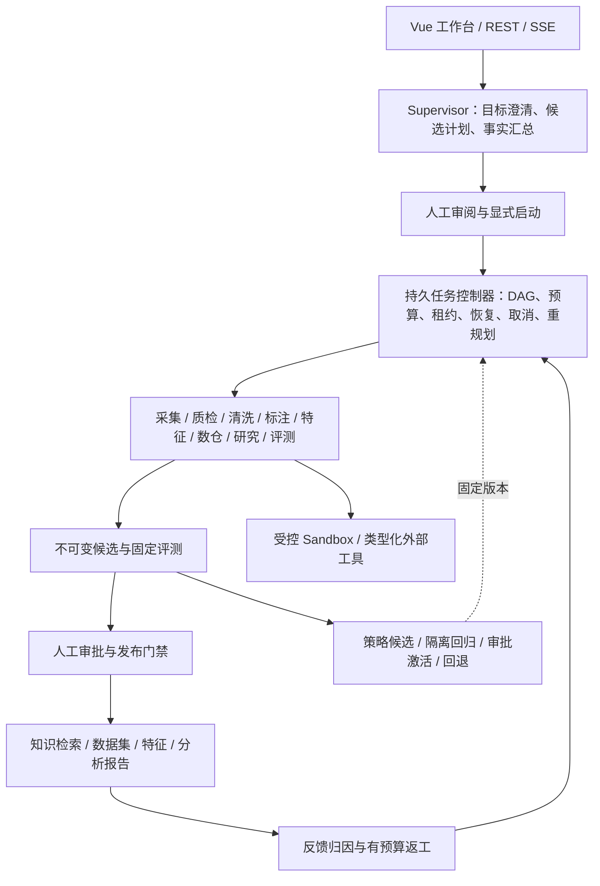

# Cognida

**以 Agent 为执行内核的数据与知识平台。** 从数据接入、质量检查、清洗与标注，到审批发布、检索分析、固定评测和反馈返工，所有阶段使用可追溯的任务、版本资产和权限边界。

[](https://go.dev/) [](https://www.python.org/) [](https://vuejs.org/)


## 能力与验收范围

更新日期：**2026-10-16**。本轮覆盖业务闭环与能力补全；RL、模型训练/部署及独立生产基础设施另行规划。实现、真实环境验收和业务质量分别记录，流程成功不代表标签、答案或研究结论已经达到业务准确率目标。

| 能力 | 当前行为与入口 |
| --- | --- |
| 统一任务控制 | `/tasks`：Supervisor 澄清目标、生成候选、人工保存和启动；类型化能力注册、DAG 分发、预算预留、持久租约、取消、SSE、重启核对和运行中重规划。在途子任务保留原计划回执，新计划仅修改未预留节点。 |
| 数据接入 | 手工文本/表格、Web、知识文档、采集候选、数据库表、SQL 结果和评测结果；认证 GET JSON API 支持受管凭据引用、分页、限额、快照和检查点。新采集及重跑只产生候选。 |
| 文档解析 | TXT、Markdown、HTML、CSV、PDF 文本层、DOCX、XLSX、PPTX；支持 DOCX 表格、XLSX 多工作表与 PPTX 表格。旧二进制 Office 文件须转换；无正文 PDF 明确失败，不将未配置 OCR 算作成功。 |
| 质量与清洗 | `/quality`、`/pipelines`：诊断、预置算子、方案预览、分页差异、移除原因、内容摘要复查；原始资产保持不可变。 |
| 知识标签与样本标注 | `/labeling`：规则和结构化模型建议、依据位置、不确定状态、人工修改保护；知识标签审核后应用到真实检索。分类、实体、关系及问答样本可审核、导出并发布。 |
| 固定数据集与评测 | `/datasets`、`/evaluation`：样本、指南、审核修订、来源、划分及内容摘要固定为不可变版本；来源分组/时间划分、精确和近重复检查；QA/RAG/Agent/SQL profile 校验，评测固定数据集和目标配置。 |
| 特征工程 | `/features`：字段、受限表达式、窗口聚合、版本化 embedding；全量/增量物化、回填、撤回、精确数值和事件时间/可用时间查询。特征 embedding 需要可信的固定模型 revision，本轮未配置该 revision，真实模型物化尚未验收。 |
| 漂移监控 | `/drift`：真实基线、数值/类别/缺失率/schema 比较、审批、定时监控、通知和治理任务；展示距离与样本量，距离不是 p 值。默认绑定选定快照；真实上游持续刷新需单独配置与验收。 |
| 数仓查询 | MySQL、PostgreSQL、ClickHouse、Doris、StarRocks、Hive；查询有界、保持精确类型、外部来源只读。Hive 和 BigQuery 使用持久异步作业、恢复、分页与取消。BigQuery 已实现凭据引用/dry-run/扫描预算，尚缺真实 GCP 项目验收。 |
| 数仓建模 | `/warehouse`：主题域、事实粒度、维度关系与分层 DAG，受限投影/关联/聚合、基数检查、增量/回填、水位及表列血缘；候选审批后切换受管版本，失败保留旧产物。 |
| 分析与研究 | Data Agent 的语义取数、Text2SQL、自我修复、分析和 A2UI；DeepResearch 支持持久运行、预算内补查、逐主张证据、支持/冲突/不足状态、同源归并和部分失败。 |
| 反馈返工 | `/feedback`：来源和失败结果定位→修正版本→有预算返工→隔离候选知识→相同样本/配置复测→门槛比较→人工审批激活→回退/撤回。源撤权和候选状态在检索、精确片段及派生资产读取时复查。 |
| 策略进化 | `/suggestions`：清洗、检索、经验、Skill、Playbook、编排六类策略的基线、候选、固定评测、确切版本审批、激活回执与回退；运行固定策略快照，不让候选直接影响正式执行。 |
| 受控 SQL / ETL | `/operations`：受管目标、类型化 DML、暂存版本、内容/身份/版本绑定确认、事务幂等回执及回退。旧确认令牌不能绕过计划直接写库；外部数仓保持只读。 |
| Sandbox | `/sandbox`：固定摘要镜像、非 root、只读根、禁网、CPU/内存/进程/时间/磁盘/输出限额、真实文件校验、取消与资源核对。当前验收的是显式授权的受控开发 profile，不宣称普通 Docker 已满足多租户不可信代码强隔离。 |

八类来源、八种文件格式及六种数据库的真实页面链路都有独立证据。数仓验证包含 **语义查询→真实引擎→Redis ResultStore→版本资产→七阶段→人工审批→报告**，并在发布后检查长整数/小数和 `00123` 文本不失真。

此前综合页面 E2E **37/37 通过**（2026-10-16），用时 8.2 分钟，零失败、零跳过、零整例重试。该轮执行清单 **81/83 项完成验收**；余下两项是实际 BigQuery 项目和固定 revision 特征 embedding 的外部验收，相关实现已具备。该轮测试服务与专用数据已清理，原有服务保留。

2026-10-16 用户确认暂无上述外部环境或受管配置引用，这两项保留为未实测，不计入通过项；该清单其余验收已完成。Hive 已通过本地真实实例验收。清单完成不代表通用业务准确率、生产容量和长期运行已经合格。

随后新增 [Hugging Face 真实数据效果基准](benchmarks/huggingface/REPORT-2026-10-16.md)：27,571 条中英文清洗保真、43,702 条官方 test 规则标注、335 条冻结模型样本、6,497 行特征与可控漂移。发现并修复混合 JSON 类型误去重，并根据独立训练样本诊断改进模型输出合同；修复前后模型成绩分别保留。该轮使用真实服务/API、存储与模型，**没有重新运行浏览器 E2E**，也未把公开数据成绩当成生产批准。

- [综合验收与质量边界](apps/cognida-web/e2e/ACCEPTANCE-2026-10-16-COMPLETE-LOOP.md)
- [公开数据协议、复现与效果报告](benchmarks/huggingface/README.md)
- [文件与人工质量基线](apps/cognida-web/e2e/ACCEPTANCE-2026-10-16-EVIDENCE-MATRIX.md)
- [数仓支持、认证、限额和实际版本](docs/implementation/query-adapters.md)
- [逐项任务与未验收项](docs/openspec/changes/complete-governed-data-loop/tasks.md)

## 架构


六层主体分别承载工作台、接入治理、任务控制、领域能力、Agent 运行时和数据基础设施；安全治理、评测与策略进化贯穿各层。图示表达职责关系，实际运行边界以上表和验收记录为准。



Supervisor 负责规划和汇总，不持有审批权限；控制器决定何时向哪项领域服务分发，领域服务执行实际工作。模型建议、机器通过和人工批准分别留痕。共享协议包含 Task、Plan、ChildHandle、Artifact、Approval，子任务以持久操作键重放，未知提交先核对再决定后续动作。

个人 Agent 默认配置通过 `/api/v1/agent/config` 按用户和工作空间保存，支持版本冲突检查、幂等重试与字段重置，并在新知识问答/交互研究中生效。已启动任务保持原参数；详见[配置字段与生效规则](services/cognida-go/internal/service/agent/preferences.md)。图谱关系统计使用真实完整聚合，Skill 列表支持分类与标签的组合过滤；旧占位拆解/派发入口已移除。语义缓存提供[按租户安全清理](services/cognida-go/internal/infrastructure/cache/cleanup.md)，尚未自动启用生产调度。

| 层次 | 技术与存储 |
| --- | --- |
| Web | Vue 3、TypeScript、Vite、Pinia、Element Plus、Playwright |
| 主服务与 Agent | Go、Gin、Eino、GORM、gRPC、MCP、SSE |
| 计算服务 | Python、FastAPI、Pandas、NumPy、SciPy、文档解析器 |
| 状态与元数据 | MySQL：任务、版本、审批、审核、策略、数据源和审计 |
| 知识检索 | Milvus 向量/BM25，授权检索、RRF、重排和精确片段读取 |
| 关系与血缘 | Neo4j：知识图谱、实体关系和血缘 |
| 缓存与传递 | Redis：队列、进度和 ResultStore；本地对象存储：不可变文件与候选 |
| 执行隔离 | Docker CLI / Engine API：固定镜像、受控 profile、资源限额与回收 |

依赖方向：`handler → service → model ← repository`。Go 管理状态、权限、审批和恢复；Python 经认证 HTTP/gRPC 执行计算，MCP 提供分析工具。

## 知识、记忆与自进化

统一 RetrievalCapability 被 REST 和 Agent 共用，支持授权范围内的向量/BM25、融合重排、查询重写、HyDE 与多跳。知识图谱按知识库配置启用。私人长期记忆以 tenant/user 隔离，支持显式保存、管理与每轮召回；当前向量排序基于最多 500 条近期候选，研究流程不自动读取私人记忆。

经验蒸馏、经验召回和 Skill 落地开关相互独立，默认关闭。新策略必须经过固定样本回归与确切版本审批，激活后固定到运行快照，撤回会阻断后续消费。此闭环改进数据与执行策略，不自动训练模型，也不默认共享私有经验。

## 权限与运行边界

- 新采集和重跑始终生成候选，历史发布回执保留。发布和反馈激活需要独立人工审批；自动执行不推导授权。
- 新接口的幂等键同时绑定身份和载荷；相同键不同载荷返回冲突，租户切换与取消不能复用旧确认。
- 来源删除、禁用、撤权、内容或连接版本变化会在对应受控消费路径重新核验。公网网页的站外变化不等于实时撤权信号；数据库快照不提供通用 CDC，支持范围见接入矩阵。
- Sandbox 默认关闭。启用须设置 `SANDBOX_ENABLED=true`、`SANDBOX_PROFILE_ACCEPTED=true`、精确授权主体、固定摘要镜像和暂存目录；未验收的强隔离 profile 拒绝启用。
- BigQuery 的本地协议/数据库测试不代替真实 GCP IAM、计费、跨请求恢复和报告验收。需要显式测试项目、凭据、位置与扫描预算。
- 文件解析、结构化标签证据与研究引用检查均有可测门槛；业务准确率仍需在实际业务样本上单独评估。

## 快速开始

### 环境要求

- **Go** 1.25.13+ · **Python** 3.11+（uv）· **Node** 20.19+（20.x）、22.13+（22.x）或 24+ · **MySQL** 8.0+ · **Milvus** 2.6+ · **Neo4j** 5.0+ · **Redis** 7.0+
- **本机开发模式**：中间件（MySQL / Redis / Neo4j / Milvus）需**预先常驻**（本机以 Homebrew services 管理 MySQL/Redis/Neo4j，Milvus 跑在 docker 容器），应用层用下方 `dev.sh` 启动。
- **容器一体化模式**：仓库根目录已提供 [`docker-compose.yml`](docker-compose.yml)，一条命令拉起**全部组件与服务**（前端 + Go + Python + MySQL/Milvus(+etcd+minio)/Neo4j/Redis），无需本机预装任何中间件，见下方「Docker 一键部署」。

### 配置参数

**配置分两层**：非密部署配置（端口 / 模型名 / base_url / 超时 / 开关…）由仓库配置文件管理，部署密钥通过环境变量或本地 `.env` 注入，不提交到 Git。加载优先级从低到高：**代码内兜底默认 < `config.yaml` < 环境变量 / `.env`**。用户登记的数据源密码和 API 来源 Token 由 `DATASOURCE_SECRET_KEY` 加密后存入 MySQL，读取 API 不回传明文；加密主密钥仍由环境注入。

| 服务 | 非密真源（入库） | 密钥来源（复制 `.env.example` → `.env`，已 gitignore） |
|------|---------|------|
| Go 后端 | `internal/config/config.yaml`（`//go:embed` 编译期打包进二进制） | `services/cognida-go/.env` |
| Python | `services/cognida-python/config/config.yaml` | `services/cognida-python/.env` |
| 前端 | — | `apps/cognida-web/.env.development`（`VITE_API_BASE_URL`） |

> **Docker 模式更省事**：只需在**仓库根目录一个 `.env`**（`cp .env.docker.example .env`）填全部密钥，compose 会注入到各容器，无需再改服务内的 `.env`。

**必填 / 常用密钥**（缺失则对应能力不可用；`JWT_SECRET` 缺失或不足 32 字节会**直接启动失败**，fail-closed）：

| 变量 | 用途 | 获取 / 生成 |
|------|------|------|
| `JWT_SECRET` | 登录令牌签名 | `openssl rand -hex 32` |
| `DB_PASSWORD` · `NEO4J_PASSWORD` | MySQL / Neo4j 密码 | 自定义 |
| `CHAT_API_KEY` | 聊天大模型（Go 侧，默认 DeepSeek） | 模型厂商控制台 |
| `EMBEDDING_API_KEY` | 向量化（默认阿里云 DashScope） | 阿里云百炼 |
| `LLM_API_KEY` | Python 侧 LLM（文档 / 评测 / 质量） | 模型厂商控制台 |
| `DATASOURCE_SECRET_KEY` | 外部数据源密码 AES-256 加密（多数据源必需） | `openssl rand -base64 32` |
| `INTERNAL_HTTP_AUTH_TOKEN` | Go/Python 内部 HTTP 共用认证；两侧须相同 | `openssl rand -hex 32` |
| `GRPC_AUTH_TOKEN` | Go/Python gRPC 共用认证；两侧须相同 | `openssl rand -hex 32` |
| `METASO_API_KEY` | 联网搜索（DeepResearch，可选） | Metaso |
| `MILVUS_TOKEN` · `REDIS_PASSWORD` | 云 Milvus / 带密 Redis（本机可留空） | 按需 |

**切换模型 / Provider**（改非密 `config.yaml`，Key 仍走 `.env`）：默认聊天模型 `deepseek-chat`（`chat.base_url: https://api.deepseek.com/v1`），Embedding `text-embedding-v3`（DashScope）。换成 OpenAI 或其它 OpenAI 兼容服务，只需改 `chat.base_url` / `chat.model_name` / `chat.provider`，Key 填到 `CHAT_API_KEY` 即可——LLM 统一弹性层承接任意 OpenAI 兼容 Provider。

### Docker 一键部署（全组件）

`docker-compose.yml` 编排全部基础设施与三个应用服务，数据库迁移由一次性 `cognida-migrate` 服务在 Go 启动前跑完（golang-migrate 版本化迁移，不自动建表）。

```bash
cp .env.docker.example .env      # 填入数据库、JWT、HTTP/gRPC 共用密钥及所需模型 API Key
docker compose up -d --build     # 首次构建 + 拉起全部服务
docker compose ps                # 查看健康状态
docker compose logs -f cognida-go
docker compose down              # 停止（加 -v 连同数据卷一起清空）
```

访问：前端 `http://localhost:8888` ｜ Go API `http://localhost:8080/api/v1` ｜ Neo4j Browser `http://localhost:7474`。
前端经 nginx 同源反代 `/api → cognida-go:8080`（含 SSE 关缓冲），无需额外配置 CORS。

### 一键启动（本机开发，推荐）

`dev.sh` 是真实的一键启动脚本，负责启停 Go 后端 + 4 个 Python 服务 + 前端，并对中间件做连通性预检。

```bash
# 先确保中间件在跑（示例：Homebrew + docker）
brew services start mysql@8.0 redis neo4j && docker start milvus-standalone

./dev.sh start      # 启动全部服务
./dev.sh status     # 查看状态
./dev.sh logs go    # 跟踪某个服务日志
./dev.sh stop       # 停止全部服务
```

### 手动分服务启动

各段在独立终端中，从仓库根目录执行：

```bash
# 1. Go 后端（:8080）
cd services/cognida-go && go run ./cmd/server
```

```bash
# 2. Python gRPC（Document/Quality，:50051）
cd services/cognida-python && uv run python -m grpc_service.server
```

```bash
# 3. Python 基础 HTTP（:8000）
cd services/cognida-python && uv run python main.py
```

```bash
# 4. Python 评测 HTTP（:18888）
cd services/cognida-python && uv run uvicorn services.evaluation.fastapi_app:app --port 18888
```

```bash
# 5. Python MCP（Analytics，:3000；本机配置 MCP_PORT=3100）
cd services/cognida-python && MCP_MODE=http uv run python -m mcp_service.server
```

```bash
# 6. 前端（:5173）
cd apps/cognida-web && npm ci && npm run dev
```

| 服务 | 端口 | 说明 |
|------|------|------|
| cognida-go（后端） | 8080 | REST / gRPC / SSE 网关 |
| cognida-python gRPC | 50051 | Document+Quality |
| cognida-python 基础 HTTP | 8000 | `main.py` 基础接口 |
| cognida-python 评测 | 18888 | FastAPI 评测计算 |
| cognida-python MCP | 3000（本机 3100） | HTTP 模式 MCP |
| cognida-web（前端） | 5173 | Vite 开发服务器（strictPort，代理 /api→:8080） |

> **数据库表结构**：业务表由**版本化迁移**（golang-migrate）管理，运行时**不自动建表**。首次启动（或改 schema 后）需先跑一次迁移——Docker 模式由一次性 `cognida-migrate` 服务在 Go 启动前自动完成；本机 / 手动模式执行：
> ```bash
> cd services/cognida-go && set -a && source .env && set +a && go run ./cmd/migrate-db up
> ```

**调用链路**：浏览器(:5173) → Go 后端(:8080) → gRPC/HTTP/MCP → Python 服务

---

## 开发与验证

业务表结构唯一真源为 `services/cognida-go/migrations/`。新增 schema 必须提交成对迁移与对应 model；运行时不自动建表。本轮迁移为 16–35，在隔离 MySQL 完成 up/down/up。

下面每一段均从仓库根目录执行：

```bash
# Go 核心回归
cd services/cognida-go
go test ./internal/...
# 真实数据库测试须先配置隔离库，不能指向业务库
go test -race -tags=integration ./internal/handler ./internal/repository/mysql
```

```bash
# Python
cd services/cognida-python
uv run pytest tests/ -q
```

```bash
# Web
cd apps/cognida-web
npm test
npm run type-check
npm run test:e2e:check
npm run build
```

E2E 使用真实账号、真实 Go/Python 服务及隔离数据库，通过页面登录、操作和检查；不使用 mock 响应代替执行。各 spec 的启用变量、fixture 和范围见 [E2E 目录](apps/cognida-web/e2e/)。验收后停止本轮启动的服务并精确回收测试资源。

[迁移手册](services/cognida-go/migrations/README.md) · [统一任务协议与恢复](services/cognida-go/internal/service/taskcontrol/README.md) · [Web 功能](apps/cognida-web/FEATURES.md) · [生命周期运行说明](services/cognida-go/internal/service/lifecycle/README.md) · [Go 功能配置](services/cognida-go/FEATURES.md)

## 后续范围

- 业务标注质量门槛、自然脏数据与复杂文档效果、真实上游连续批次、峰值并发和长期恢复验收；公开基准不替代这些生产条件。
- 真实 GCP 项目上的 BigQuery 外部验收。
- 配置可信固定模型 revision 后，验收特征 embedding 的真实模型物化。
- 多租户不可信代码的独立执行节点、微虚拟机等更强隔离环境验收。
- Agentic RL、奖励与策略训练、模型训练/微调及部署回路。
- K8s/Helm、镜像发布、自动扩缩容和完整生产运维体系。

[实施设计](docs/openspec/changes/complete-governed-data-loop/design.md)和[执行清单](docs/openspec/changes/complete-governed-data-loop/tasks.md)保留实际边界及验收证据，不将跳过的外部能力计为完成。

## 许可证

[MIT](LICENSE)
