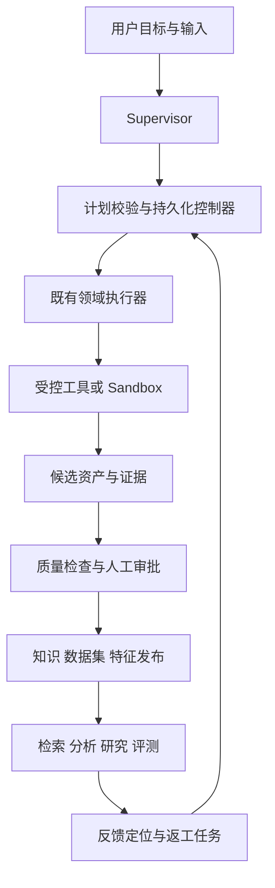

## Context

本设计以 2026-10-15 的 main `1ee1a3c` 为调研基线，范围见 [proposal](proposal.md)。调研与文档更新后已开始基础实施；当前优先任务控制契约、计划预检、持久化与 Runner 契约，完成状态以 [任务清单](tasks.md) 及实际验收为准。草稿保存与结构预检不等于执行器、实时进度或统一工作台已交付。

现有证据：8 类来源的处理主路径已通过真实页面验收，详见 [验收记录](../../../../apps/cognida-web/e2e/ACCEPTANCE-2026-10-15-UI.md)。该记录不覆盖通用 API 采集、全部文件格式、各数仓引擎、标签准确性、研究事实正确性或长期运行质量。

| 领域 | 已有实现与证据位置（仓库相对路径） | 本轮计划补齐 |
| --- | --- | --- |
| 执行 | `services/cognida-go/internal/service/lifecycle/`、`services/cognida-go/internal/service/collection/`、`services/cognida-go/internal/service/governance/` 已有队列、版本引用、审批、取消、重试和恢复 | 跨域父任务、受约束规划、子任务关联和总预算 |
| 清洗与标签 | `services/cognida-go/internal/service/lifecycle/contracts.go` 已有清洗专家；`services/cognida-go/internal/service/governance/annotation.go`、`services/cognida-go/internal/service/governance/tagging.go` 已有规则处理和人工审核 | 诊断与差异预览、语义建议、问答标注、审核产物接入消费方 |
| 数据集与评测 | `services/cognida-go/internal/model/evaluation/entity.go`、`services/cognida-go/internal/service/evaluation/` 已有数据集和任务比较 | 不可变数据集发布、固定样本与配置、返工及发布门禁 |
| 发布 | `services/cognida-go/internal/wire/features_access.go` 将文本发布知识库，表格保存版本对象 | 审核标签进入元数据、版本发布记录、撤回和失效传播 |
| 数据源 | `services/cognida-go/internal/service/datasource/driver.go` 注册 MySQL／PostgreSQL，接口依赖 `*sql.DB` | 数仓 QueryAdapter、方言、类型、限额和真实引擎验证 |
| 特征 | `services/cognida-go/internal/service/governance/features.go` 已有 field 投影、版本和 as_of 查询 | 自动变换／聚合、物化、批量消费和时间正确性 |
| 漂移 | `services/cognida-python/services/quality/drift_detector.py` 有统计检测框架 | 替换以均值方差生成随机基线的做法，保存真实基线并接通产品流程 |
| 研究 | `services/cognida-go/internal/service/agent/research.go` 已规划、检索、综合并验证引用与原文摘录 | 主张支持、矛盾来源、证据不足后的补充调查 |
| 操作 | `services/cognida-go/internal/service/agent/tools/sql_mutate.go`、`services/cognida-go/internal/service/agent/tools/etl_run.go` 已有受控工具；默认 Data Analysis 不注册 Operation | 独立、持久化的操作计划与审批入口、提交状态核对 |
| 策略进化 | `services/cognida-go/internal/service/agent/experience/` 已有蒸馏、图谱／Skill 沉淀与默认关闭的开关；`services/cognida-go/internal/service/agent/presets/data_agent/playbooks.go` 加载静态策略 | 候选版本、隔离评测与审核激活、运行策略快照、监测回退 |
| 数仓建模 | `services/cognida-go/internal/service/semantic/` 已有逻辑表／维度／指标建模和发布；`services/cognida-go/internal/service/lineage/` 已有语义依赖与上下游查询 | 事实粒度与分层转换计划、增量回填、加工版本及变更影响审核 |
| 前端 | 工作总览、流水线、专家、两类标注、特征、研究、评测页面已存在 | 复用并贯通任务、版本、审批、反馈导航，不重建第二套工作台 |

表中为完整仓库相对路径。旧 OpenSpec 变更记录提供设计背景；实际支持状态以代码、配置和验收为准。

## Goals / Non-Goals

**Goals:** 完成业务闭环和能力补全：用户可以从明确来源发起任务，理解清洗与打标变更，审核后将产物用于知识检索或评测；质量问题能定位、返工、复测和有依据地发布。候选执行策略通过评测及审核后生效；数仓建模与加工、特征、漂移、深研和受控操作在同一权限与产物体系内工作。

**Non-Goals:** Agentic RL、奖励模型、策略训练、模型微调与部署；K8s／Helm、自动扩缩容等独立生产化工程；无限自主爬取；直接改写外部原始业务表；自动共享私人记忆。当前计划保留必要的恢复、限额、审计和 Compose 接线，不将其称为完整生产化。

## Decisions

### 上层规划与执行边界

Supervisor 负责理解目标、识别缺少的输入、生成候选计划和解释结果。持久化控制器负责校验计划、授权、依赖、预算与状态推进；实际工作由已有领域执行器完成。

新增父任务记录保存 `task_id`、身份、目标、输入引用、计划版本、预算、最终结果和取消状态；子任务绑定领域类型与真实 `run_id`／`invocation_id`／评测 ID。父任务不复制领域作业的全部状态，也不直接修改领域表。提交使用确定性幂等键，父子绑定与投递采用事务记录和恢复扫描；状态回调／轮询须核对 attempt 与版本，取消后停止父任务继续推进；已提交的发布／写入回执必须保留。跨越提交边界的取消先记 cancel_requested／结果待核对，对账后显示真实终态和补偿选项，不能显示为“未执行”，也不能重放写入。

计划只能从能力注册表生成有界无环图；每个节点声明输入输出、所需权限、工具、重试与预算。执行前校验，保存计划快照。重规划生成新版本，只替换尚未执行节点；涉及目标、权限或写入范围变化时重新审批。已有顺序／并行／Supervisor 原语可复用，不能直接作为跨请求持久化控制器。

首批预检检查结构、能力声明、引用和当前生命周期资产权限；草稿持久化保存任务与计划快照，预检返回诊断，不提交领域任务、运行脚本或发布资产。原来源失效传播尚未完成，响应必须说明授权检查范围。未接执行器时必须明确不能执行；预检成功不授予执行权限，后续提交和恢复仍需重新授权。任务 API/SSE 与列表／详情的完整交付必须包含真实执行状态及页面验收，不能仅凭预检和草稿接口勾选对应任务。

### Sandbox 契约

先定义 Runner 的 submit/status/cancel/collect 接口，输入是已授权的不可变引用、固定镜像摘要、代码摘要和资源策略；输出是结构化 manifest、日志摘要、资源消耗和候选文件引用。工具参数不可指定宿主路径、镜像任意地址或服务凭据。

本地／受控开发环境先实现 Docker runner：非 root、只读根文件系统、最小 capabilities、系统调用限制、独立临时目录、CPU／内存／进程数／磁盘／超时限制、默认禁网。控制组件可以管理运行时，但执行容器不得获得 Docker socket、宿主目录或生产密钥。输入只读复制，输出校验大小、类型、路径、符号链接、归档展开和摘要后才能登记资产；目录清理由 runner 负责。

取消必须终止任务进程树；控制器重启后按持久化执行 ID 处理孤儿任务。预置算子优先用受控 Worker，无需每次 Agent 推理都启动 Sandbox。多租户不可信代码在启用前须完成独立执行节点／更强隔离运行时的验收；普通 Docker profile 不能标成已经满足这一条件。先保留 gVisor 等运行时接口，是否启用由兼容性验证决定。

Docker 的 namespace/cgroup 与权限设置是不同层面的控制，容器本身不能替代策略配置；gVisor 增加用户态内核隔离，也有兼容性成本。[Docker 官方说明](https://docs.docker.com/engine/security/)、[gVisor 官方说明](https://gvisor.dev/docs/)。

### 清洗、知识标签与样本标注

复用 `data-cleaning` 专家，增加 profile → 清洗计划 → 样本预览／逐行差异 → 生成新版本 → 复检。规则先行，语义判断以建议形式展示；自定义代码必须走 Sandbox。质量报告同时展示保留率、删除原因、缺失值和敏感数据处理，不用单个总分掩盖损失。

知识打标 Agent 使用版本化标签方案，输出标签、依据、方法和不确定项；人工改动清除旧审核状态。审核通过后，由受控发布器写入知识资产元数据和检索过滤索引，保存应用回执，重复应用幂等。已有摘要／实体／关键词等增强能力继续复用。

样本标注 Agent 复用 classification／named_entity／relation，新增 question_answer；标签定义、指南、标注方法和审阅版本均留存。支持人工纠正、争议复核和低置信拒答，不以模型自报置信度代替准确率。

样本标注类型与评测 profile 分开定义：QA 需要 question/reference_answer；RAG 增加授权知识范围、相关文档／分块及上下文；Agent 增加预期工具／步骤；SQL 增加数据源、方言和只读 gold_sql。分类／实体／关系数据可作为通用标注数据集发布，但不能自动伪装成 QAPair；转换到四类评测前必须满足该 profile 的 schema，缺字段或不支持的组合在发布前拒绝。已审核样本才能进入数据集发布；私有对话和长期记忆不得自动转为共享训练／评测样本。

### 不可变数据集、反馈与发布

数据集逻辑 ID 下增加不可变版本，manifest 固定样本 ID／摘要、来源版本、标签方案、审核状态和划分策略。训练／验证／测试划分按来源组和时间规则实施，并检查重复及近重复泄漏；本轮只产出数据，不运行训练。旧 `dataset_id` 请求在创建评测时解析并固定具体快照，页面显示实际版本，不能运行中读取被修改的 latest。

评测记录固定数据集版本、目标配置、提示词／模型标识、检索参数和 grader 版本。复用现有 compare 服务，增加一致性前置检查与预先配置的业务门槛；门槛随基线版本保存，不能事后为通过而调低。候选知识／标签先在隔离的候选视图评测，通过后审批激活；不能先污染线上知识再比较。

反馈条目绑定问题、真实输出与证据，归因到采集／清洗／标签／检索／研究，并生成有次数和预算上限的修复任务。通过审批的修复触发新版本和固定基线复测；失败保留旧活动版本。共享经验、Skill 和私人记忆使用不同发布目标和权限，保持现有默认门控。

发布记录保存活动版本、索引状态、审核人及消费目标。数据库与向量／对象存储之间采用可重试事件和对账，不假装跨存储原子事务。撤回切换活动版本并失效缓存；删除／权限撤销先在读取层阻断，再异步清理索引和派生副本。不得为“回退”恢复已被删除或已失去权限的数据；历史报告保留审计关联并标记失效。

### 受治理的策略进化

在既有经验蒸馏、Skill 加载、静态 Playbook、检索参数和规则之上，新增类型化策略产物。每个候选保存 tenant、可见范围、来源证据、类型、不可变版本／摘要、依赖及变更差异；候选不得自动进入运行中的技能目录或活动策略。保留经验写入／召回的默认门控，私人对话与长期记忆不得自动成为组织共享内容。旧静态配置先登记为基线快照，现有蒸馏和技能产出接入候选适配，不另建一套推理内核。

候选在隔离上下文中与固定数据集、模型／grader 配置及预设门槛比较，只允许声明的策略差异。通过后由人审核确切版本和作用范围，幂等激活并核对实际加载结果；模型自报置信度和旧经验前置筛选不替代质量评测。策略只能在服务端允许的参数范围内调整，不得改变租户授权、工具权限、审批要求、Sandbox 边界或凭据。

每次运行固定实际采用的经验／Skill／Playbook／检索规则及编排策略版本，重试读取同一快照，缓存键包含作用域和版本；重规划若修改策略须形成新计划版本。来源权限和策略可用性仍在执行及恢复时重查，撤权或禁用不能以复现为由继续消费。监测按策略版本记录质量、错误率和成本变化，退化产生有证据的停用／回退建议，由授权人确认后切换到仍有效的版本；已有运行保留真实采用版本与限制，不用回退改写历史。这里的进化是有界候选修订与评测发布，不包含 RL、模型权重更新或策略训练。

### 接入和数仓

为 Web、认证 HTTP API、文件、库表分别建立支持矩阵：鉴权、分页／游标、解析格式、记录上限、快照、增量水位、重试和删除检测。API 先覆盖 GET + JSON 的分页／游标模式和受管凭据引用，暂不把任意协议都标为支持；文件范围按真实解析器逐格式验收。保留公网抓取的 SSRF、重定向和域名限速。

现有 Collection 服务会直接 Ingest 到知识库，这是必须处理的兼容路径。新统一任务使用 candidate-only 采集，只登记原始／规范化候选资产；正式知识索引在发布审批后写入。旧入口的新建／再次运行也接入同一发布授权与审批流程，UI/API 明示 waiting_approval，不能通过 legacy 参数直接入库。历史已完成入库回执保留，恢复时先核对已有提交，不重新发布；迁移前运行中的旧任务需排空或由显式恢复策略接管。该行为变化须出迁移说明并验收“采集完成、审批未完成时正式检索不可见”。

引入 QueryAdapter 能力描述，包含元数据、方言、类型映射、参数绑定、执行／取消、服务端限额和结果分页；兼容现有 SQL Driver。上层结果使用列类型和精确值，不向通用调用者强制暴露 `*sql.DB`，以容纳 BigQuery job 与 Hive 操作句柄。默认只读权限、服务端最小权限、语句检查和超时共同约束，不只依赖关键字黑名单。

| 接入批次 | 范围与技术选择 | 完成条件 |
| --- | --- | --- |
| W0 | 将 MySQL／PostgreSQL 包装到新接口，保持现有行为 | 原有元数据、查询、语义、数值精度和权限回归通过 |
| W1 | ClickHouse 使用官方 Go 客户端；Doris／StarRocks 复用连接协议但分开实现方言、类型和元数据适配 | 三种真实引擎分别通过连接、选表、语义查询、取消、权限拒绝和报告验收 |
| W2 | BigQuery 官方客户端的异步任务与费用上限；HiveServer2 会话／鉴权／操作取消适配 | 真实项目／集群验证，不以 MySQL 模拟或编译通过替代 |

W2 仍在本计划范围内，只是依赖独立环境。BigQuery 的 dry run 与 maximum bytes billed 用于费用控制，LIMIT 不能普遍充当扫描费用上限；Hive 必须明确 TLS、认证方式和用户身份映射。[BigQuery 官方说明](https://docs.cloud.google.com/bigquery/docs/best-practices-costs)、[HiveServer2 官方说明](https://hive.apache.org/docs/latest/admin/setting-up-hiveserver2/)。

ClickHouse 可通过官方 Go 客户端接入；Doris 的 MySQL 协议兼容不意味着类型与 SQL 行为完全相同。[ClickHouse 客户端](https://clickhouse.com/docs/integrations/language-clients/go/index)、[Doris 兼容性说明](https://doris.apache.org/docs/4.x/query-data/mysql-compatibility/)。固定具体引擎和客户端版本后再登记支持状态。

### 数仓建模与分层加工

数仓建模 Agent 复用现有语义模型、指标口径、资产目录和血缘服务，补充主题域、事实表粒度／键、维度关系及原始→明细→汇总→应用层定义。Agent 输出可审阅的模型与转换建议，不直接发布语义模型或执行 DDL。模型版本固定授权输入、列类型、关联基数、口径和转换 SQL／代码摘要；现有管理员可信表达式不能使模型生成的 SQL 自动可信，须校验受限表达式、引用与方言，预览关联重复、粒度变化和聚合差异。

分层转换组成有界 DAG，绑定模型版本、输入快照、参数及目标，由任务控制器调用 QueryAdapter 和受控操作执行器。外部数仓仍是只读来源；加工输出仅在已登记且授权的受管派生空间。读取引擎支持不等于获得该引擎写权限，未实现的执行或目标能力明确拒绝。预置转换走受控算子／SQL，自定义脚本遵守 Sandbox；候选生成与检查完成后才按审批切换活动版本，失败保留旧产物。

增量执行显式定义稳定键、水位、分区、更新／删除与迟到数据策略。提交分区及幂等回执后才能推进水位；中断按操作标识对账，不能重放已完成写入。回填固定历史范围与配置，产出可区分的新版本，不能改写既有评测快照或事后污染时点特征。来源不支持一致快照或删除检测时明示限制，不假装支持完整增量语义。

在现有语义上下游查询之上记录实际转换的表／列依赖及版本，变更前展示受影响的模型、指标、报告、特征和数据集。无法解析的依赖标明未知；涉及执行授权或安全切换的关键依赖未解析时阻止发布。模型、SQL、输入或目标变化使旧审批失效；执行回执与实际血缘登记后再声明交付成功。不是重建指标语义层，也不要求自建数仓服务。

### 自动特征与漂移

扩展现有特征定义为 field、受限 expression、window_aggregate、embedding。数值／类别算子先实现；向量类固定真实模型与版本，不用哈希或随机向量冒充语义模型。定义经类型与来源校验，物化任务记录分区、水位、输入版本和输出摘要，支持重试、回填、撤回和跨特征批量读取。计算优先下推到受限查询或分批 Worker，不把全表塞进 prompt／单次内联 JSON。

同时保存事件时间和可用时间，按 as_of 读取时排除未来数据和事后补写数据；离线宽表和分析读取使用同一计算定义。借鉴时点关联语义，当前阶段不强制引入 Feast 等新平台。[时点关联说明](https://docs.feast.dev/getting-started/concepts/point-in-time-joins)。

漂移必须使用固定的真实参考快照或有记录的确定性采样，不能按均值方差重建随机正态样本。先覆盖数值分布、类别频率、缺失率及 schema 变化；记录样本量、效应大小、统计方法和业务阈值，小样本返回证据不足。漂移只表示分布变化，不自动推断业务质量下降；监控异常生成治理／补采任务，经审批后才更换基线。

### DeepResearch 与受控操作

DeepResearch 在现有流程增加 claim 列表、引用支持关系、冲突来源和待核实事项。同源转载不能被算作多个独立佐证；证据不足时在限定预算内补充调查，耗尽后输出部分报告及限制。引用格式、逐字摘录校验与语义支持是不同状态。保留知识库授权和联网开关，以人工标注研究样本验收，不能仅依赖另一个模型给自己的报告打分。

操作入口与默认只读分析隔离，复用现有 `sql_mutate`／`etl_run` 和审计。新增操作计划固定输入、目标、SQL／代码摘要、预估影响及有效期；确认令牌绑定 tenant/user/action/version/hash，执行时复查权限和数据前置条件。目标仅为受管派生空间，不开放原始业务表或外部数仓写入。

数据库支持事务时保持 DML 与幂等记录一致；非事务派生流程分阶段记录与对账。现有 replace 路径先删除旧派生表的行为必须改为 staging 生成成功后再切换，失败时保留旧产物。待确认操作的取消在服务端立即失效对应令牌。提交响应丢失时标记结果待核对，通过确定性操作 ID 查证，不能直接重试一次写入。回退能力按目标显式声明：事务回滚、切换派生版本或补偿；无法撤销的操作不能显示“可回滚”。

### 页面与交付顺序

2026-10-15 用户指定统一控制部分的实施顺序为 **Supervisor → 能力接入 → 多 Agent 协作和任务分发验证 → Sandbox**。Supervisor 先支持缺项澄清、只读候选生成、现有计划校验和用户确认保存；候选生成没有持久写入，刷新只恢复已保存快照。后续能力接入复用受控领域服务，自定义代码保持不可执行，直到 Sandbox 单独验收。

沿用现有风格和组件。新增统一任务列表／详情；在已有页面增加任务、版本和审批链接：清洗差异面板、两类标注工作台的应用／数据集发布动作、评测版本选择与比较返工、数仓动态连接表单、特征物化／漂移详情、研究证据面板和独立操作审核页。策略版本、差异、评测和回退复用建议审核／评测／任务页面；数仓建模复用语义模型与血缘页面，增加事实粒度、分层 DAG、增量范围和影响预览。任务进度来自持久状态，明确草稿、待审核、部分完成、失败、超时、取消及待核对，刷新／重连不能重复执行。

| 阶段 | 交付与依赖 | 退出条件 |
| --- | --- | --- |
| A 契约和基线 | 冻结任务／产物／审批契约、来源矩阵、指标与环境清单 | 每项功能都有入口、消费方、拒绝路径和验收证据要求 |
| B 统一控制与 Sandbox | 父任务适配既有执行器；隔离 runner；任务详情 | 重启、重复提交、取消、资源耗尽不造成重复发布或越权 |
| C 数据治理 | 清洗差异、知识标签应用、四类样本标注、数据集版本 | 审核前不可消费；审核后实际影响知识过滤或固定评测样本 |
| D 反馈闭环 | 先完成旧采集候选化／审批迁移及检索隔离，再接基线比较、返工、激活／撤回、失效传播 | 一次真实错误反馈完成修复和复测；失败候选不影响活动版本 |
| D+ 策略进化 | 依赖 B 的运行契约、C 的固定样本及 D 的评测发布；复用经验／Skill／Playbook | 候选不泄漏至运行，运行快照可追溯，退化被阻止且回退实际生效 |
| E 接入与数仓 | W0 → W1 → W2，可在 B/C 时按独立文件并行 | 每个承诺的来源、格式、引擎独立真实验收 |
| E+ 数仓建模 | 复用语义与血缘，依赖 B/D、E 对应引擎及 G 的受控操作能力 | 粒度和聚合手算一致，增量／回填恢复不重复写入，变更影响可审阅 |
| F 特征与漂移 | 依赖 C 的版本与 D 的反馈入口，可与 E 并行 | 手算特征值一致、无未来泄漏、真实基线可复现、异常可返工 |
| G 深研与受控操作 | 依赖 B 的执行边界及 D 的发布证据，可与 E/F 并行 | 研究冲突／不足可解释，写入确认绑定且恢复不重复提交 |
| H 综合验收与文档 | 汇总 A–G，含 D+ 与 E+ | 全部范围状态有证据；未具备真实环境的项保留未验收 |

B→C→D 是第一条可交付闭环；旧采集入口的候选化、审批迁移和审批前检索隔离属于 D 的强制前置，不延后到 E。E/F/G 的新增来源／数仓等扩展能力不阻塞这条主路径，但未完成时不能声称第 2 组全部交付。不提供未经任务拆分和环境验证的精确工期承诺。

D+ 延续第 1 组的反馈发布机制，E+ 补齐第 2 组的数仓建模目标；两者均在本变更范围，未验收时不能用第一条闭环的成功替代。E+ 可先做只读建模与预览，受管加工启用必须等待对应执行器与目标能力验收。

## Risks / Trade-offs

- 跨域双重调度 → 父任务只存绑定与汇总，领域执行器保留唯一状态真源。
- 跨存储发布部分失败 → 候选版本、幂等回执、事件对账与活动指针分离；读取先检查有效性。
- Sandbox 运行时不支持限制 → 能力检查失败即拒绝该执行 profile，不回退为宿主执行。
- 大数据规模超过现有内联计算上限 → 明确采样／分区／流式处理计划；超限失败可见，不静默截断成完整成功。
- 标签或研究质量不可用 → 使用人工标注基线、分类型指标、拒答和复核，不设置无业务依据的统一准确率承诺。
- 外部环境或云凭据未提供 → 实现可继续，真实验收保持待验证；不得降低支持矩阵标准或伪造成功。

## Migration Plan

实施时在 main 按模块新增成对 SQL 迁移并同步 model；使用隔离测试库执行 up/down/up 与老版本兼容验证。旧任务、输入引用和模板版本继续读取；旧数据集在新评测创建时生成固定快照，不改写已完成历史成绩。

先发布兼容模型与只读入口，再启用新任务／runner／发布功能；逐项开关默认关闭未验收能力。回退先停止新增任务、等待或取消在途操作，再回退应用；保留新增表和对象用于核对，不自动运行破坏性 down。关闭新入口不应影响已有查询与历史结果。

## Open Questions

实施前置清单：各数仓引擎的版本、TLS／认证方式和隔离验收环境；BigQuery 测试项目、位置及费用上限；HiveServer2 鉴权与身份映射；Sandbox 执行节点和允许的镜像／依赖；业务标签方案、样本复核人及质量门槛；允许修订的策略类型／参数、审核人及回退阈值；数仓事实粒度、受管加工目标与迟到／删除处理规则。这些细节在对应模块启用前登记，未落实的能力保持不可执行，不阻塞其他已明确范围的基础实施。

## Acceptance

贯穿样例：同一批带重复记录、错误类别与更新文档的数据，先采集并保留原件，再清洗、打标／标注和审核。知识查询必须命中新版本的真实文档／分块且标签过滤生效；结构化报告必须与手算结果一致；审核问答样本发布为固定数据集版本。对错误答案发起反馈、追溯来源、返工、复测和审批切换；同时验证退化候选被拒、旧版本可切回、已撤权内容不可重新出现。

策略验收沿同一固定基线验证候选→评测→审核→激活→监测回退，证明未审批策略不进入运行、默认配置改变不改写在途快照、禁用版本不能从缓存恢复。数仓验收使用有明确事实粒度、重复关联和迟到记录的真实数据，检查分层汇总与手算一致、审批前无加工写入、增量中断／重复投递／回填保持一致，以及模型变化的影响清单和旧产物保留。

每个阶段包含核心单元测试、真实数据库集成、HTTP 接口测试及真实页面操作；跨服务与外部引擎测试禁止用 fixture 成功替代实际调用。异常验收覆盖跨租户、权限变化、重试幂等、进程重启、审批失效、取消、超时、部分失败和提交结果未知。统计／模型质量另用固定人工样本评估，不以流程成功率代替。

文档更新执行 OpenSpec 校验、链接与状态一致性检查及独立 Review；实施项另按实际测试证据逐项完成，未运行的业务验收保持未完成。预检与持久化基础的测试不替代执行器、页面或外部引擎验收。实施完成后按仓库流程 Review、提交，并停止任务启动的服务。
